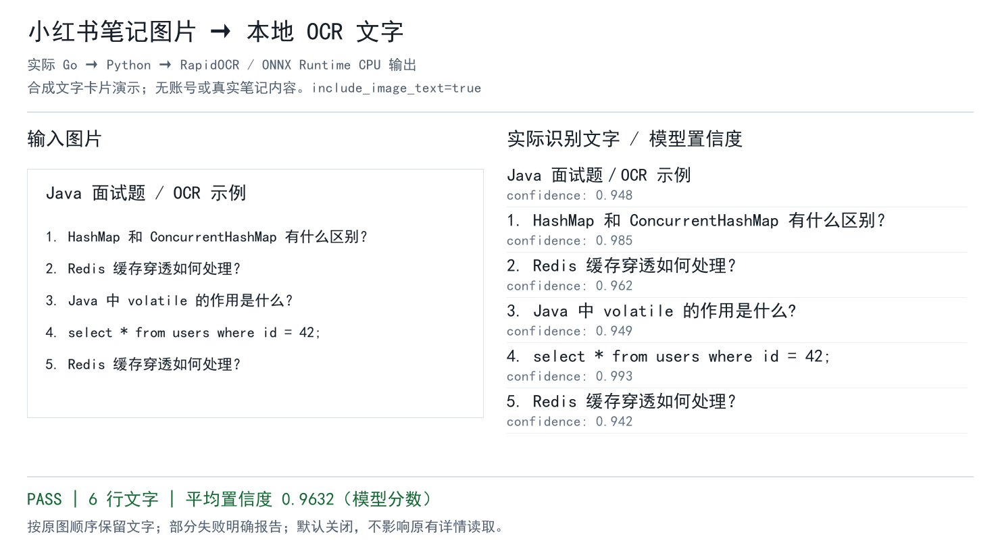

# 可选的本地图片文字识别 / Optional local OCR

笔记的教程、面经和代码截图往往只在图片中。`get_feed_detail` 和 `POST /api/v1/feeds/detail` 新增可选参数 `include_image_text`，启用后使用 RapidOCR + ONNX Runtime 在本机 CPU 上提取文字，并保留逐图来源和置信度。

**默认关闭**，原有读取不需要 Python。识别不调用云端模型，不生成答案，也不对正文或图片文字去重。适合文字卡片和截图，不提供照片内容描述；代码符号和低置信度行仍应结合原图核对。

## 安装

需要 Python 3.11+；仅在希望使用 OCR 的服务端安装以下可选依赖：

```sh
python -m venv .ocr-venv
# Linux / macOS
.ocr-venv/bin/python -m pip install -r scripts/requirements-ocr.txt
export XHS_OCR_PYTHON="$PWD/.ocr-venv/bin/python"
export XHS_OCR_SCRIPT="$PWD/scripts/ocr_images.py"
```

Windows PowerShell：

```powershell
python -m venv .ocr-venv
& .\.ocr-venv\Scripts\python.exe -m pip install -r scripts/requirements-ocr.txt
$env:XHS_OCR_PYTHON = (Resolve-Path .\.ocr-venv\Scripts\python.exe).Path
$env:XHS_OCR_SCRIPT = (Resolve-Path .\scripts\ocr_images.py).Path
```

在同一个环境下启动 MCP 服务，确保这两个绝对路径对服务进程可见。Docker 用户需在自己的镜像中额外安装 Python、依赖及脚本；现有官方镜像不因本功能自动包含 OCR 环境。RapidOCR 和模型遵循各自的许可。

## 调用

MCP 工具 `get_feed_detail` 参数：

```json
{
  "feed_id": "从搜索结果取得的笔记ID",
  "xsec_token": "从搜索结果取得的令牌",
  "include_image_text": true
}
```

HTTP 请求在原有 `POST /api/v1/feeds/detail` JSON 中加入同一字段即可。省略或设置为 `false` 不会启动 OCR 子进程。

原始 `feed_id`、`data` 和评论/视频字段保留。新增结果字段：

- `text_content`：标题、正文和按原图顺序排列的图片文字；关闭 OCR 时只含标题和正文。
- `image_texts`：每张图片的 `index`、`url`、`text`、平均 `confidence`，以及逐行 `lines[].text/confidence`。
- `image_texts[].error`：单张图片下载或识别失败原因，保留该图片的位置。
- `ocr_error`：未配置环境、批次失败或部分图片失败的摘要。OCR 失败不影响原始详情和正文返回。

图片成功但没有识别到文字时，`text` 为空，合并文本标明“未识别到文字”；这与下载/识别失败分别表示。置信度是模型分数，不是经过校准的准确率。

## 执行与限制

- 图片地址只接受 `*.xhscdn.com`，下载前升级为 HTTPS，并在跟随每次重定向之前校验目标地址。
- 单张下载超时 20 秒、大小上限 20 MiB；整批 OCR 最多等待 150 秒，也遵循调用方 context 取消。
- 每次调用启动独立 Python 进程并加载模型，CPU 识别通常需要数秒至数十秒；多张图片可能超时。客户端如需识别，应给详情调用设置足够的超时。
- 不保存图片、不把 Base64 图片加入文本结果。图片来自原始详情，优先 URLDefault，缺失时回退 URLPre。
- 输出保留原图顺序和重复文字，不静默跳过失败图片。整批结果数量与原图不一致时报告不完整。

## 验证

```sh
go test . -run '^TestImageText'
.ocr-venv/bin/python -m unittest discover -s scripts -p test_ocr_images.py -v
```

Go 的子进程协议测试在能找到 `python3` 时运行，也可通过 `XHS_OCR_TEST_PYTHON` 指定解释器。该测试不需要模型；Python OCR 测试使用已安装依赖并替换引擎输出，覆盖顺序、重复文字、空图、失败、大小限制和重定向校验。

实际模型演示使用自制文字卡片，不含账号或其他人的笔记内容：



## English

Pass `include_image_text: true` to `get_feed_detail` or the feed detail HTTP API to opt into local CPU OCR. Install the optional requirements and set `XHS_OCR_PYTHON` and `XHS_OCR_SCRIPT` to absolute paths before starting the service. OCR is disabled by default, so existing clients need no Python installation.

`text_content` combines the title, body and image text in the original order without deduplication. `image_texts` includes per-image/per-line confidence and errors. OCR failures preserve the original note and body; `ocr_error` explicitly reports missing or partial recognition. This extracts written text, not general visual descriptions.
