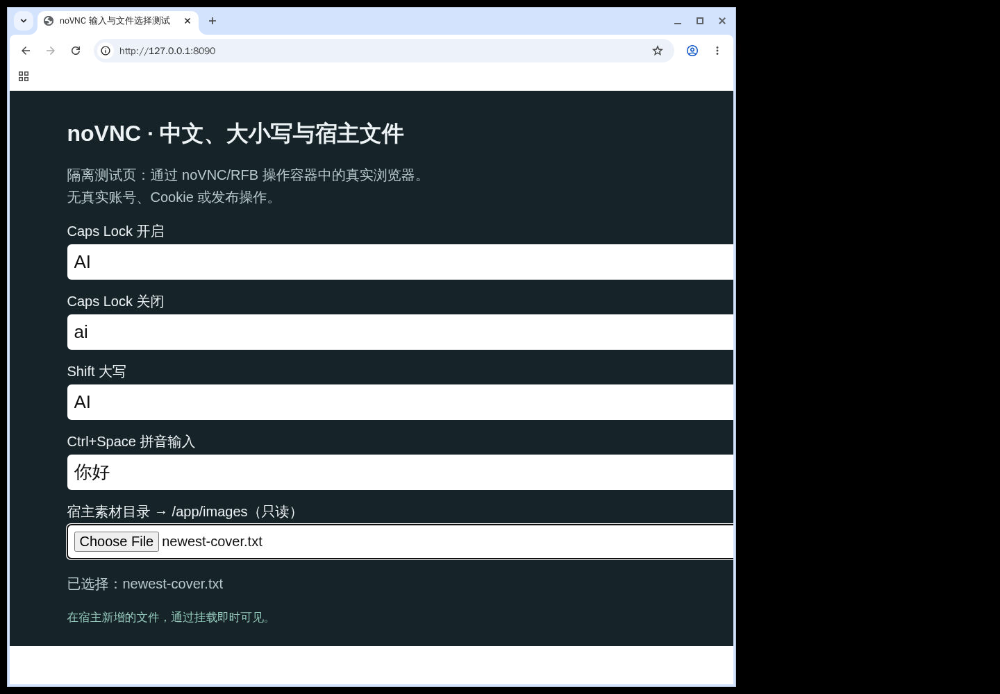
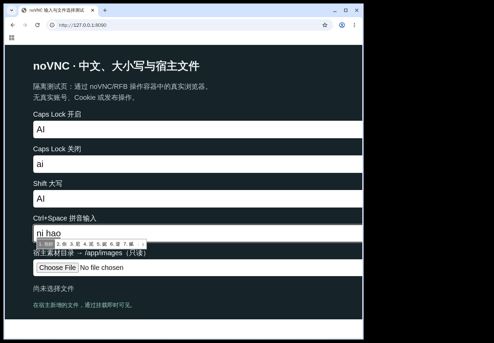
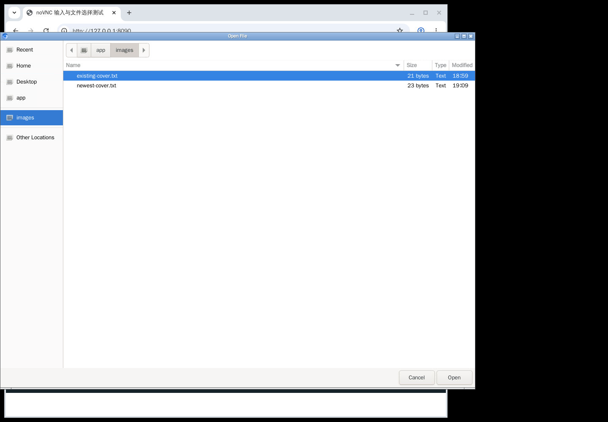
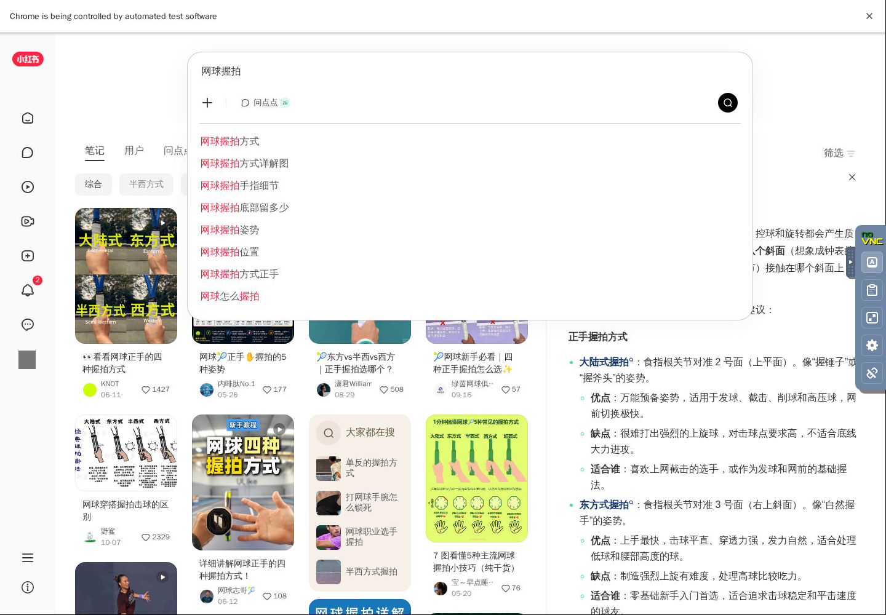
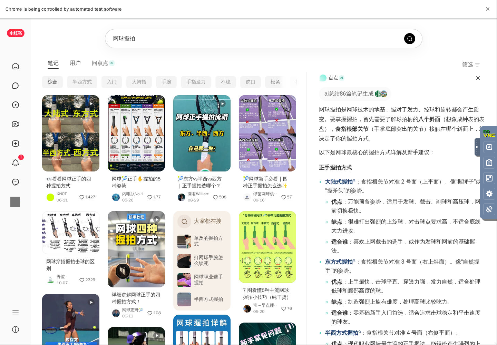

# 可视化部署实测

## 合并前补充验证（2026-11-01）

维护者在 macOS / OrbStack 的 Linux/amd64 独立测试容器中补充验证，未使用真实账号或 Cookie：

- 默认无 GUI 标签保持不变；GUI 新增 `novnc`、`vX.Y.Z-novnc`，两款同步发布 Docker Hub / 阿里云，GUI 基于同次发版的无 GUI digest 构建。发布流程经 actionlint 校验；实际推送在下一次正式发版执行。
- 输入法改为 Ubuntu 仓库提供的 Fcitx5 Rime，移除 Qt WebEngine。英文、Shift、Caps Lock、`nihao` → “你好”、Ctrl+Space 双向切换，以及系统文件窗口选择容器启动后新增的宿主素材均通过真实 RFB 键鼠事件验证。
- MCP 鉴权、noVNC WebSocket/RFB、只读素材、组件正常/异常提前退出、MCP 退出码、组件故障后重启和 SIGKILL 后显示锁恢复通过。启用 `cap_drop: ALL` 和 `no-new-privileges` 后仍通过。
- 桌面连接仅接受配置的本机 Origin，跨站和缺失 Origin 的 WebSocket 连接均被拒绝；这不等于增加桌面密码，仍不可直接暴露公网或不可信 Docker 网络。
- Grype v0.121.0（校验官方发布资产 SHA256）使用当天数据库对官方 v2.5.5 基线与 GUI 镜像比较：GUI 新增/升级 High、Critical 为 0。保留基础镜像已有告警，按维护者决定后续单独处理；此结果不代表整款镜像没有漏洞。
- 本地测得未压缩镜像：基线约 1.16 GB，原桌面层约 1.97 GB，Rime 版约 1.58 GB。构建时仅临时调整本机软件包下载路径，成品来源配置已恢复，仓库 Dockerfile 没有加入下载转发。

可重复验证的脚本为 `smoke_test.py`（含 `input_test.py`）及 `check_vulnerabilities.py`；Docker CI 对同次代码构建的两款镜像执行检查，并保存漏洞报告。

下面保留原始投稿的演示记录；其中输入法截图对应切换 Rime 之前的 Fcitx5 内置拼音版本。

下方“输入和文件选择”“启停与访问”使用隔离测试环境：Windows 宿主、Docker Desktop 的 Linux/amd64 容器；基础镜像为官方 `v2.5.5`（digest `sha256:5bc690d0c7907f069886ddeb6b37abbe4bdd37bd431975b914c7c27435b1b602`）。

测试实例使用独立空白 data 与只读素材目录。先调用原服务的获取登录二维码接口，让 **MCP 自己启动浏览器**；未扫码登录，再经 noVNC 将该窗口导航到容器内的本地测试页。截图里的输入框是隔离测试页，不是小红书发布页。

## 输入和文件选择

真实 noVNC JavaScript 客户端通过 WebSocket/RFB 发键盘和鼠标事件；没有向远端输入框注入文字。测试页记录实际 input/change 事件：

- Caps Lock 开：`AI`；关：`ai`。
- Shift 大写：`AI`。
- Ctrl+Space 切换英文→拼音→英文，`nihao` + 空格得到“你好”。
- 容器启动后在宿主新增 `newest-cover.txt`；点击系统文件窗口的 **images** 书签，选中文件并点“打开”，网页收到该文件名。
- 容器尝试写入 `/app/images` 被只读挂载拒绝。

## 启停与访问

- Compose 配置校验、镜像构建、启动脚本 `bash -n` 通过。
- `/health` 返回 v2.5.5；noVNC 页面及真实 RFB 连接通过。
- MCP、noVNC 发布端口均只绑定宿主回环；原始 VNC 未发布。
- 设置测试 AUTH_TOKEN 后，未带 token 的 MCP API 返回 401。该 token 不保护 noVNC。
- 正常重启后，MCP、显示器、输入法恢复；素材书签没有重复追加。
- 对测试容器执行 SIGKILL 后重新启动通过：陈旧 X 锁被清理。另起第二个显示启动脚本时拒绝占用仍在使用的显示，原服务保持正常。
- 单独结束 x11vnc 时，容器以非零码退出；重新启动后桌面与 API 恢复。

没有改动原 Dockerfile、原 docker-compose.yml 或 Go 服务。上述隔离测试没有运行真实账号的登录/发布/互动，也没有实测 Linux 或 macOS 宿主、ARM 镜像、跨机器 SSH 转发；不将上述局部验证写成完整发布流程已通过。

## 真实小红书浏览与中文搜索

以下三张截图来自已有的集成部署，复用其已登录的 MCP 浏览器，经 noVNC 操作同一个窗口；仅按贡献规范遮盖当前账号头像，其余为实际浏览画面。它们展示真实使用场景，不将这一环境的登录态归为上方官方 v2.5.5 空白实例的测试结果。

1. **已登录的公开首页**：左侧可见登录后的“我”入口，头像已遮盖；右侧保留 noVNC 工具栏。

2. **中文搜索输入与联想**：通过 noVNC 键盘事件，Ctrl+Space 切到 Fcitx5 拼音，输入拼音后选择页面联想中的“网球握拍”；图中再次聚焦搜索框展示搜索词与联想。没有向网页输入框注入文本。

3. **真实搜索结果**：选定“网球握拍”后进入公开搜索结果，搜索词、笔记列表及 noVNC 工具栏同屏可见。

截图前在原浏览器新增公开浏览标签并进入全屏，不显示原有后台标签栏；截图仅包含公开首页和搜索界面，没有笔记管理、创作后台、私信或凭证。未重新登录、复制 Cookie、重启原容器或执行发布、点赞、评论、关注等操作。

## 重现方式

按 README 在独立测试目录启动此 Compose；通过获取登录二维码工具打开 MCP 浏览器，但不扫码。将该窗口导航到自己托管的本地 HTML（包含普通文本输入框和 `<input type="file">`），从 noVNC 依次输入上述字符并选择挂载文件即可复核。

重启检查使用 `docker compose restart`；强制结束与组件故障测试只对独立测试容器进行。停止后使用原 data 再次启动，应恢复桌面并保留输入法配置和素材书签。
