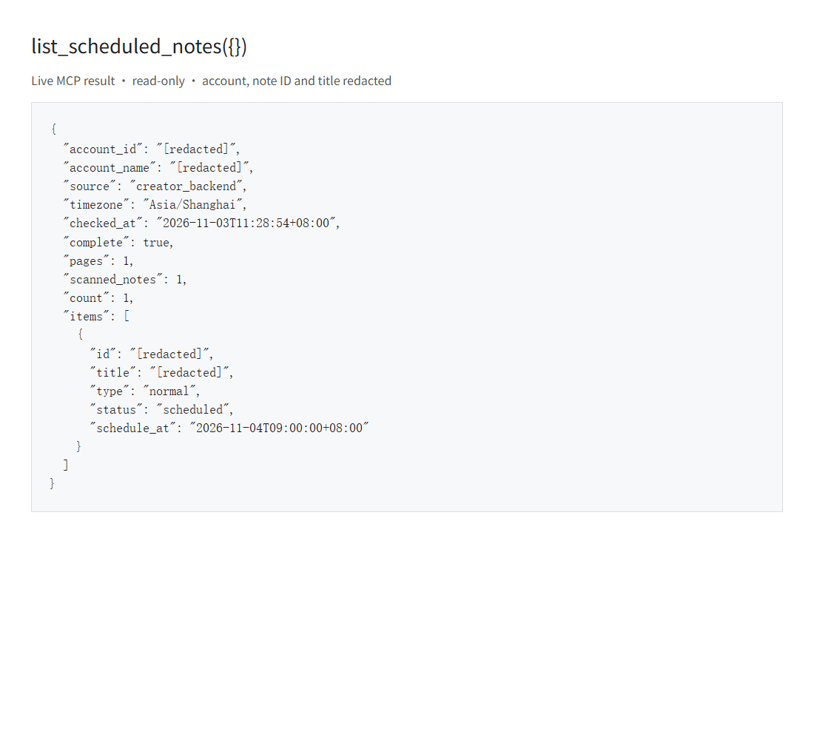

# 查询后台预约

`publish_content` 和 `publish_with_video` 可以创建预约；`list_scheduled_notes`
用于只读查询当前登录账号已有的全部有效预约，包括在创作者中心手动建立的图文和视频预约。

## 调用

MCP 参数为空对象：

```json
{"name":"list_scheduled_notes","arguments":{}}
```

REST 接口：

```http
GET /api/v1/notes/scheduled
```

沿用服务现有鉴权。MCP 返回 JSON 文本，REST 使用现有的 `success/data/message` 包装。

结果包含 `account_id`、`account_name`、`checked_at`、`timezone`、`complete`、
`pages`、`scanned_notes`、`count` 和 `items`；每条预约包含 `id`、`title`、`type`、
`status`、`schedule_at`。预约时间使用 RFC3339，例如 `2026-11-04T09:00:00+08:00`。

## 完整性与失败处理

工具打开创作者中心笔记管理的“全部”页，通过 CDP 读取页面自身请求的响应，使用
go-rod 滚动到分页哨兵加载更多。不自行生成请求签名，不操作发布、编辑或取消预约控件。

只有后台返回终止游标 `page=-1`，且读取的唯一笔记数与后台总数相符，才会返回
`complete: true`。正常的空列表为 `items: []`、`count: 0`、`complete: true`。
登录失效、网络异常、分页不完整、重复笔记、总数变化、缺失字段或未知状态均报错，
不能把这些情况当作没有预约。

查询最多等待三分钟，每次响应后的无进展等待上限为 35 秒。该方式依赖创作者中心
当前的页面选择器和后台字段；大量历史笔记或网站改版可能导致查询失败。查询结果
不是后台的原子快照，需要提交新预约的调用方应在提交前重新查询。

## 验证

- 使用 Go 1.27.3 运行根包、业务包及其他包测试，包含跨页读取、图文/视频、空列表、
  不完整响应、异常状态、错误时间单位，以及 MCP 工具注册和 REST 鉴权测试。
- 在真实账号通过 MCP 读到一条既有的次日 09:00 预约，`complete=true`。未创建、
  修改或取消预约；真实账号只有一页，多页行为由单元测试覆盖。
- 演示为真实 MCP 查询结果的浏览器展示截图；账号、笔记 ID 和标题已在渲染前替换为
  `[redacted]`。截图不包含登录数据。


